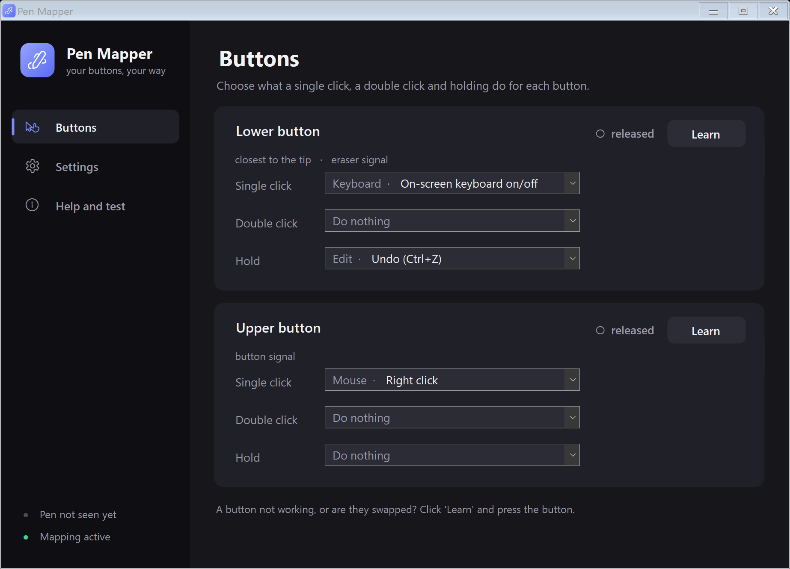
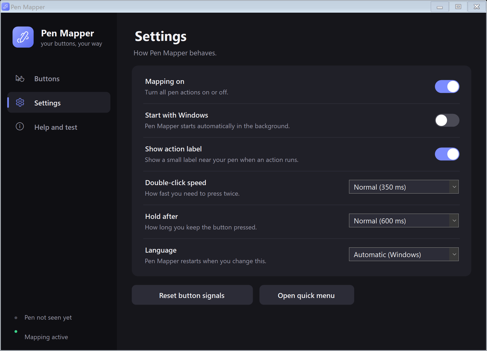
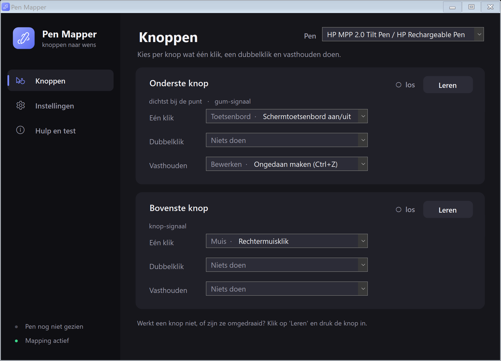

# Pen Mapper

**Give the buttons on your Windows pen your own functions.**
Single click, double click and hold — separately for each button.



## Download

Get **`Pen Mapper Setup.exe`** from the [latest release](../../releases/latest) and run it.
No administrator rights needed. Uninstall any time via *Windows Settings → Apps*.

> Windows may show a SmartScreen warning ("unknown publisher") because the app is not code-signed yet.
> Click **More info → Run anyway**.

## Features

- **Three actions per button** — single click, double click and hold
- **60+ actions** — mouse clicks, undo/redo, copy/paste, on-screen keyboard, snipping tool, zoom,
  tab and window switching, media keys, presentation controls, and more
- **Custom actions** — record your own keyboard shortcut, type a piece of text, or open any program or website
- **Quick menu** — a menu with every action, right at your pen
- **Pen profiles** — pick your pen, or use **Learn** to teach Pen Mapper any button
- **Works while hovering** — reads the pen directly, so buttons work without touching the screen
- **Dutch and English**, dark modern design, runs quietly in the system tray, optional start with Windows



## Supported pens

Pen Mapper works with **Windows Ink pens** on touchscreen laptops and tablets:

| Pen type | Examples |
| --- | --- |
| MPP (Microsoft Pen Protocol) | HP MPP 2.0 Tilt Pen, HP Rechargeable Pen, Dell Active Pen, Lenovo Active Pen, Asus/Acer active pens |
| Microsoft Surface | Surface Pen, Slim Pen |
| Wacom AES | Pens for Lenovo, Fujitsu, Samsung and other AES devices |
| USI | USI-compatible pens on Windows devices |

Tested with the HP MPP 2.0 Tilt Pen. For other pens the button signals are best-effort defaults —
if a button doesn't respond, click **Learn** next to it and press the button.

Not supported: the Bluetooth top button of the Surface Pen, external drawing tablets that use
their own driver (e.g. Wacom Intuos), Apple Pencil.

## Building from source

Only Windows is needed — the C# compiler that ships with .NET Framework 4.8 is used, nothing to install.

```powershell
powershell -ExecutionPolicy Bypass -File build.ps1
```

The output goes to `dist\`:

- `Pen Mapper.exe` — the app
- `Pen Mapper Setup.exe` — the installer (contains the app)

To code-sign both files, pass a code-signing certificate:

```powershell
powershell -ExecutionPolicy Bypass -File build.ps1 -CertPfx mycert.pfx -CertPassword ****
```

| File | What it is |
| --- | --- |
| `App.cs` | The app: UI, pen input (HID Raw Input), gestures, actions |
| `Setup.cs` | The installer |
| `build.ps1` | Draws the icon, compiles both, optionally signs |

---

## Nederlands

**Pen Mapper** geeft de knoppen van je Windows-pen eigen functies: één klik, dubbelklik en vasthouden, per knop apart.
Download **`Pen Mapper Setup.exe`** bij de [nieuwste release](../../releases/latest).
Werkt met Windows Ink-pennen (MPP, Surface, Wacom AES, USI). Kies je pen in het menu, of gebruik **Leren** voor elke andere pen.


